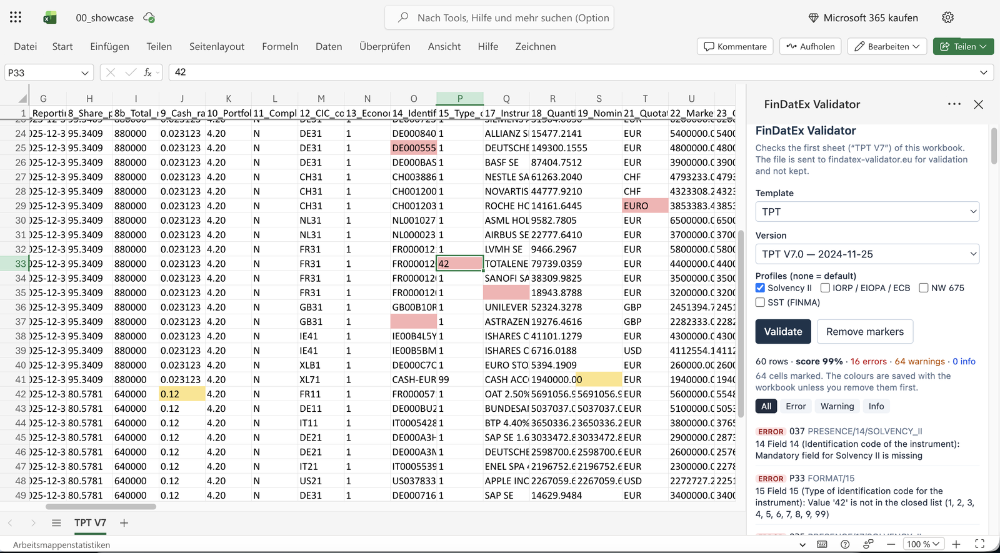

# Excel add-in (prototype)

An Office.js task-pane add-in that validates the open workbook without leaving
Excel and colours the cells that have findings. It is served by the web app
under `/addin/` (unlinked, `Disallow`ed in robots.txt) and talks to the same
`/api/*` endpoints as the React app — there is no second rule engine.

| | |
|---|---|
| Runs in | Excel on the web (Microsoft 365 or a free Microsoft account), Excel for Microsoft 365 on Windows and Mac, Excel 2019+ on Mac (ExcelApi 1.9) |
| Does not run in | Excel 2016/2019 perpetual on Windows (ExcelApi ≤ 1.8), Excel 2013 and older; Excel 2021/2024 perpetual is untested |
| Install | Sideload of `manifest.xml` — no admin rights, unless the tenant blocks user add-ins |
| Data | The workbook is uploaded to the server for validation, exactly like the web upload (not kept) |

## Trying it (sideload)

The manifest is public: <https://www.findatex-validator.eu/addin/manifest.xml>.
Download it, then:

- **Excel on the web:** open a workbook → *Home* → *Add-ins* → *More Add-ins*
  → *My Add-ins* → *Upload My Add-in* → choose `manifest.xml`.
- **Excel for Microsoft 365 on Windows:** the same *Upload My Add-in* dialog
  (*Home* → *Add-ins* → *More Add-ins* → *My Add-ins*). Where that is not
  offered: put `manifest.xml` into a shared folder, add the folder's UNC path
  under *File* → *Options* → *Trust Center* → *Trust Center Settings* →
  *Trusted Add-in Catalogs* (tick *Show in Menu*), restart Excel, then
  *My Add-ins* → *Shared Folder*. Neither needs admin rights.

A sideloaded add-in appears as **FinDatEx → Validate file** on the *Home* tab.

## How it works

1. The pane (`web-app/src/main/frontend/addin/taskpane.html`, code in
   `src/addin/`) loads the templates and lets the user pick template, version
   and profiles.
2. *Validate* reads the open workbook as `.xlsx` bytes with
   `Office.context.document.getFileAsync(Office.FileType.Compressed)` and
   posts it to `POST /api/validate` as `workbook.xlsx`. The server reads the
   **first worksheet**, as for any upload — the pane says which sheet that is.
3. The cell of each finding comes from `GET /api/annotated-source/{reportId}`:
   its `findingCells` triples `[findingIndex, mirrorRow, mirrorCol]` mirror
   the first sheet 1:1 (Excel row = mirrorRow + 1, Excel column = mirrorCol,
   mirrorCol 0 = row-level → column A). `src/addin/marks.ts` turns them into
   A1 addresses (`marks.test.ts`).
4. Marked cells get a fill by worst severity (red / amber / blue). The
   original fills are read first and kept in the pane's memory; *Remove
   markers* puts them back. They are lost when the pane is closed — the
   colours then stay until removed by hand or undone, and are saved with the
   workbook.
5. Clicking a finding selects its cell. Findings without a cell (file or fund
   level) are listed but not marked.

Not in the prototype: per-cell notes/comments, choosing another sheet,
external (GLEIF/OpenFIGI) checks, a store listing.

## Server side

- `AddinFramingFilter` is the **only** place the strict headers are relaxed,
  and only for `/addin/*`: no `X-Frame-Options`, CSP with
  `frame-ancestors` = Office hosts and `script-src`/`connect-src` +
  `https://appsforoffice.microsoft.com` (office.js must be loaded from
  Microsoft's CDN). Pane and manifest are `no-cache`. `AddinFramingFilterTest`
  pins both sides.
- Manifest and icons are static backend resources
  (`web-app/src/main/resources/META-INF/resources/addin/`), so they exist in
  `-P backend-only` builds; the pane is the second Vite entry
  (`vite.config.ts`, `rollupOptions.input`).
- Validation runs from the add-in are counted as ordinary web runs; the pane
  sends no page view.
- Validate the manifest after editing it:
  `npx office-addin-manifest validate web-app/src/main/resources/META-INF/resources/addin/manifest.xml`.
  Its `<Id>` is fixed — a new one makes Office treat it as another add-in.

## Test status

- **Excel on the web: works** (tested 2026-11-14 with `samples/tpt/00_showcase.xlsx`,
  personal Microsoft account): sideload, validate, cell colours, jump to cell.
- **Excel desktop behind TLS inspection:** a corporate proxy that re-signs
  HTTPS (its own CA as issuer) can make Excel desktop reject the add-in with a
  certificate warning while Edge opens the same URLs fine. Nothing to fix on
  the server; use Excel on the web or have `www.findatex-validator.eu`
  exempted from inspection.

## Open questions

- Does `getFileAsync` include unsaved edits in Excel on Windows? (If not, the
  pane must ask the user to save first.)
- Does office.js need further CSP hosts in some tenant? The browser console of
  Excel on the web shows blocked requests.
